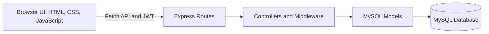
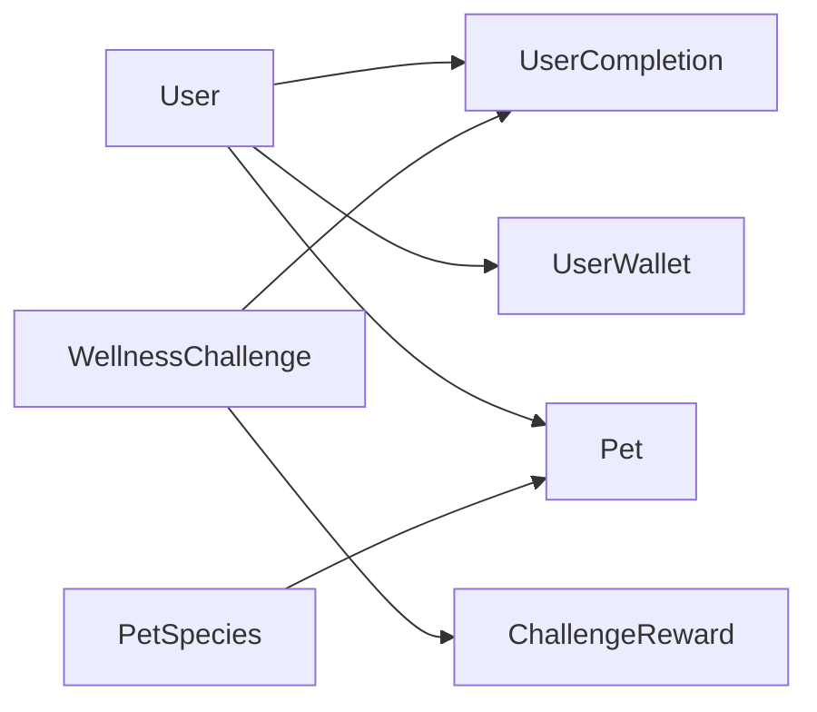

# Wellness Challenge — Gamified Full-Stack Web Application 🌱

   

**A gamified wellness application that encourages everyday healthy habits through challenges, progress tracking, rewards, and adoptable virtual pets.**

This individual back-end web development project connects a Node.js/Express API to a MySQL database and a browser-based HTML, CSS and JavaScript frontend. Users can register, sign in, complete wellness activities, earn coins and points, customise their challenge experience, and care for virtual pets.

> **Project scope:** Educational prototype. The source has been packaged for portfolio review, not production deployment. See [implementation limitations](docs/PROJECT_NOTES.md).

## Highlights

| Feature | Implementation |
|---|---|
| 🔐 User accounts | Registration, login, bcrypt password hashing, JWT-based API authentication |
| ✅ Wellness challenges | View, create, update and complete challenges |
| 🪙 Rewards | Points, coin wallet and pet experience (XP) |
| 🐾 Virtual pets | Species/rarity, adoption and active pet selection |
| 📈 Dashboard | Completion summaries, activity history and Chart.js visualisation |
| 🏆 Leaderboard | Ranking by accumulated points |

## Architecture and technical stack



- **Back end:** Node.js, Express, REST APIs, MySQL2, JSON Web Tokens, bcrypt
- **Front end:** HTML5, CSS3, JavaScript, Fetch API, Chart.js
- **Database:** MySQL with tables for users, challenges, completions, wallets, pet species, pets and challenge rewards
- **Development:** npm, `.env` configuration, Git

### Database design

The app uses seven MySQL tables. This is a **conceptual relationship overview**; the original coursework schema does not declare every relationship as a foreign-key constraint.



*For the exact table definitions, see [`src/configs/initTables.js`](src/configs/initTables.js). The original coursework ERD image is available in the prepared portfolio archive, but has not been uploaded here.*

## How it works

1. Users register or sign in. Passwords are hashed before storage; successful login returns a JWT.
2. The browser attaches the token to protected API requests.
3. Users complete challenges to track activity and accumulate points and rewards.
4. Coins can be used in the pet feature, and active pets can gain experience.
5. The dashboard reads progress, leaderboard and owned-pet data from backend endpoints.

**Example API areas:** `POST /auth/register`, `POST /auth/login`, `GET /auth/me`, `GET /challenges`, `GET /users/leaderboard/top`, `GET /pets/species`. See `src/routes/` for the full routing surface.

## Run locally

**Prerequisites:** Node.js and npm, a running MySQL server, and a local database account that can create a database.

1. Clone the project and install dependencies:

   ```bash
   git clone https://github.com/tyunfei/wellness-challenge-web-app.git
   cd wellness-challenge-web-app
   npm ci
   ```

2. Copy `.env.example` to `.env` and replace the placeholder values with your **own local** MySQL credentials and a newly generated random JWT secret. Do not commit `.env`.

3. Create the database and seed demo tables **only on a disposable local database**:

   ```bash
   npm run create_schema
   npm run init_tables
   ```

   ⚠️ **Important:** `init_tables` drops and recreates the app tables. It will erase existing data with the same table names. Do not run against a database you need to preserve.

4. Start the application:

   ```bash
   npm start
   ```

5. Open `http://localhost:3000` in your browser and register a demo account.

**Testing status:** The portfolio package has passed JavaScript syntax checks and a static HTML-asset reference check. The API and MySQL setup have **not** been exercised end to end in this environment.

## Repository guide

```text
wellness-challenge-web-app/
├── .env.example                   # Placeholder-only environment settings
├── index.js                       # Server entry point
├── package.json / package-lock.json
├── src/
│   ├── app.js                     # Express app setup
│   ├── configs/                   # Database creation / seed script
│   ├── controllers/               # Request handling
│   ├── middlewares/               # JWT and password helpers
│   ├── models/                    # Database queries
│   ├── routes/                    # API definitions
│   └── services/db.js             # MySQL connection pool
├── public/                        # Frontend pages, scripts, CSS and pet images
└── docs/PROJECT_NOTES.md          # Implementation and security caveats
```

## My contribution

An individual Singapore Polytechnic **Back-End Web Development** coursework project. I developed the server-side routes, controllers and models; authentication and database interaction; and the associated frontend interface and gamification features. This portfolio edition preserves the original project while making the source easier to explore and run locally.

## Limitations and next improvements

This is an academic prototype. Production hardening would require additional resource-ownership checks, transaction-safe rewards, server-side validation, authentication/security review, and automated tests. The pet artwork's redistribution rights should also be checked. Details are documented in [Project Notes](docs/PROJECT_NOTES.md).

**Author:** Yun Fei · [GitHub](https://github.com/tyunfei) · [LinkedIn](https://www.linkedin.com/in/toh-yun-fei/)
